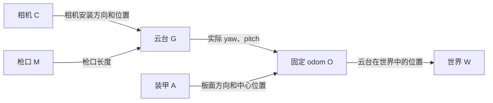

# 学员 ROS 2 接口手册

先按 [README](../README.md) 启动仿真。你的程序负责读取装甲位置，算出瞄准角，再决定是否开火。

## 1. 需要接收和发送什么

你需要接收 3 个话题，发送 1 个话题。`/clock` 由 ROS 自动处理。

| 方向 | 话题 | 消息类型 | 用来做什么 |
|---|---|---|---|
| 接收 | `/aim_sim/armors` | `rm_aim_sim_bridge/msg/ArmorCornersArray` | 获取每块装甲的四个三维角点 |
| 接收 | `/aim_sim/gimbal` | `rm_aim_sim_bridge/msg/GimbalState` | 知道云台现在转到了哪里、转得多快 |
| 接收 | `/aim_sim/telemetry` | `rm_aim_sim_bridge/msg/Telemetry` | 获取弹速、重力等发射参数 |
| ROS 自动接收 | `/clock` | `rosgraph_msgs/msg/Clock` | 使用仿真里的时间 |
| 发送 | `/aim_sim/command` | `rm_aim_sim_bridge/msg/AimCommand` | 告诉云台转到哪里，以及是否开火 |

armors、gimbal、telemetry 的更新频率通常约为 60 Hz，相同时间戳的数据来自同一次采集，但不一定同时到达你的程序。command 建议以 50 Hz 发布。

订阅和发布时，QoS 使用 reliable（可靠传输）、volatile（不保存历史消息）、depth=1（只缓存最新一条）。

## 2. 先弄清位置和角度

收到的四角坐标都使用 `odom` 坐标系：**以云台旋转中心为原点，X 指向零位前方，Y 向左，Z 向上，单位是米。**

例如 `(4, 0.2, -0.3)` 表示：在云台零位前方 4 m、左边 0.2 m、比旋转中心低 0.3 m。Z 为负不代表在地下。

odom 的方向不会跟着云台转。云台转动时，一个静止目标的 odom 坐标仍然不变。收到的坐标已经算好了安装高度和场景偏移，可以直接使用。

| 角度 | 0 表示什么 | 正数表示什么 |
|---|---|---|
| yaw | 云台朝向 odom 的 +X | 向左转 |
| pitch | 枪口水平 | 抬头 |

角度单位是 rad。发送的是**最终想转到的角度**：当前 yaw=0.2，希望到 0.3，就发送 0.3。

ROS 收发的 pitch 都使用“抬头为正”。默认 ROS pitch 范围是 `[-20°, +30°]`，实际范围看场景配置。

相机光心、云台旋转中心、枪口是三个位置：相机默认装在旋转中心前方 0.08 m、上方 0.04 m，枪口默认在前方 0.22 m。这些安装偏移会跟着云台转动。弹道要从枪口开始计算。各坐标系的换算公式放在第 9 节。

## 3. `/aim_sim/armors`：装甲在哪里

| 字段 | 怎么理解 |
|---|---|
| `header.stamp` | 仿真生成这批四角数据时的时间 |
| `header.frame_id` | 固定为 `"odom"`，表示下面的点都按第 2 节的坐标定义 |
| `session_id` | 这批数据的会话编号，用来识别重置、暂停恢复等操作 |
| `armors` | 这次看见的装甲列表；一块装甲是一组四点 |
| `armors[i].corners[0..3]` | 第 i 块装甲的四角，每个点都有 x、y、z，单位 m |

从装甲板正面看，四点依次是：**左上、右上、右下、左下**。装甲转动后仍保持这个编号，不按图像里的左右位置重新排序。

四点围成的矩形就是仿真的命中区域。默认宽高与内置黑色装甲板主体的外接矩形一致，不扣除外观模型的裁角和灯槽。你需要自己计算中心、板面方向，并选择要打的装甲。

装甲没有固定 ID。上一帧的第 0 块，不一定是这一帧的第 0 块，需要你自己判断两帧中的装甲如何对应。

只有朝向相机、亮着灯、且灯条四个端点都在画面里的装甲才会发出来。命中矩形与灯条的尺寸不同，所以给出的命中矩形角点可能在画面之外。

**armors 为空，就表示这次没有可用目标。** 出画、背向相机、灭灯、战亡、暂停或关闭外部控制都可能导致为空。被打中的装甲会灭灯 50 ms 仿真时间。

重置、仿真重启、暂停/恢复或切换本地/外部控制后，`session_id` 会变化。看到编号变了，就丢掉旧目标、之前算出的速度和还没发送的结果，再用新数据重新计算。发指令时，始终复制所用观测的 header 和 session_id。

## 4. `/aim_sim/gimbal`：云台现在转到了哪里

消息类型为 `rm_aim_sim_bridge/msg/GimbalState`，直接按字段读取角度和角速度。

| 字段 | 怎么理解 |
|---|---|
| `header` | 与同一次采集的 armors 相同 |
| `yaw` | 当前 yaw，单位 rad，向左为正 |
| `pitch` | 当前 pitch，单位 rad，抬头为正 |
| `yaw_velocity` | 当前 yaw 转动速度，单位 rad/s，向左转为正 |
| `pitch_velocity` | 当前 pitch 转动速度，单位 rad/s，抬头为正 |

例如，C++ 回调中直接使用 `msg->yaw`、`msg->pitch` 读取实际角度，使用 `msg->yaw_velocity`、`msg->pitch_velocity` 读取角速度。这四个字段均为 `float64`。

你发出的 command 是“希望转到哪里”，这里收到的是“实际转到了哪里”。判断是否瞄准到位，要看这里的实际角度。

这次测试中我们在仿真中使用的是理想云台，理想云台会立即采用收到的目标角，但消息传输和反馈更新仍然需要时间。

## 5. `/aim_sim/telemetry`：发射参数

消息类型为 `rm_aim_sim_bridge/msg/Telemetry`，包含 `header` 和下面五个 `float64` 数值字段，直接读取即可。

| 字段 | 含义 | 单位 | 默认值 |
|---|---|---|---|
| `header` | 与同一次采集的 armors 相同，包含仿真时间戳和 odom 坐标系 | — | — |
| `speed` | 弹丸离开枪口时的速度 | m/s | 23.0 |
| `gravity` | 重力加速度大小，方向向下，即 odom 的 −Z | m/s² | 9.7833 |
| `barrel_length` | 云台旋转中心到枪口的距离 | m | 0.22 |
| `rate` | 持续开火时的射击频率 | Hz | 10.0 |
| `delay` | 一次射击被安排后，到弹丸真正出膛的等待时间 | s | 0.015 |

参数以当前收到的值为准。delay=0.015 表示射击安排后等待 15 ms 才出膛，不包含弹丸飞到目标的时间。出膛方向由当时实际云台角度决定。

例如，C++ 订阅回调中直接读取：

```cpp
void on_telemetry(rm_aim_sim_bridge::msg::Telemetry::ConstSharedPtr msg)
{
  const double speed = msg->speed;                  // m/s
  const double gravity = msg->gravity;              // m/s²
  const double barrel_length = msg->barrel_length;  // m
  // 使用这些数值计算弹道。
}
```

## 6. `/clock`：使用仿真的时间

给学员节点设置 `use_sim_time=true` 后，`this->now()` 就会使用 `/clock` 中的仿真时间，不需要自己订阅。

暂停时，仿真时间不再增加；重置后回到 0。算目标速度时，使用两帧观测时间的差。两帧时间相同就不能除以这个时间差；时间回退或 session_id 变化后，要丢掉旧的速度估计。

检查“多久没收到消息”应使用 `std::chrono::steady_clock`，因为仿真暂停或断流时，仿真时钟也可能停止。

## 7. `/aim_sim/command`：让云台怎么动、是否开火

| 字段 | 怎么填写 |
|---|---|
| `header` | 直接复制这次计算所用的 armors 消息的 header |
| `session_id` | 复制同一条 armors 消息的 session_id |
| `yaw` | 希望云台转到的 yaw，rad，向左为正 |
| `pitch` | 希望云台转到的 pitch，rad，抬头为正 |
| `enable` | true 表示允许执行这条控制，false 表示停止控制和射击 |
| `fire` | true 表示持续允许开火，false 表示不再安排新的射击 |

| enable | fire | 云台会怎么做 |
|---|---|---|
| false | 任意 | 停止控制和射击，取消还在等待出膛的射击 |
| true | false | 转向目标角度，不安排新的射击；已经安排、正在等待出膛的仍会完成 |
| true | true | 转向目标角度，并按 rate 持续射击 |

已经飞出枪口的弹丸不会因为停火而消失。桥接也不会帮你判断是否瞄准到位，什么时候允许开火由你的程序决定。

指令要满足以下要求，否则会被丢弃：

- 仿真正在运行，界面已打开外部控制。
- header 和 session_id 来自同一份观测，frame_id 为 odom。
- yaw、pitch 是有效数字，不是 NaN 或无穷大，绝对值不超过 1000 rad。pitch 超出机械限位时会被限制到边界。
- 观测时间不能早于本会话开始时刻，也不能早于上一条已采用指令的观测时间。同一帧可以更新计算结果。
- 观测不能太旧。默认超过 250 ms 就会失效，也不能比桥接最新的仿真时间超前 50 ms 以上。

默认超过 250 ms 没有有效指令或没有新仿真状态，桥接会停止控制和射击。反复发送旧结果不能延长这个时间。旧指令被拒绝时，当前有效指令继续执行，直到收到新指令或超时。

**收到空的装甲列表时，发送 enable=false、fire=false。** 发这条停止指令时，仍使用这条空观测的 header 和 session_id。

发送代码：

```cpp
rm_aim_sim_bridge::msg::AimCommand command;
command.header = observation.header;
command.session_id = observation.session_id;
command.yaw = target_yaw;
command.pitch = target_pitch;
command.enable = have_valid_target;
command.fire = allow_fire;
command_pub_->publish(command);
```

不要把 header.stamp 改成计算结束或发送时的时间。即使结果是异步算出来的，也要保留它原来使用的观测时间和会话编号。

## 8. 编译和查看消息

编译学员包前，先加载仿真工作空间的 `ros2_ws/install/setup.bash`，并让学员包依赖 `rm_aim_sim_bridge`。学员使用的自定义消息头文件为：

- `rm_aim_sim_bridge/msg/armor_corners_array.hpp`：装甲四角。
- `rm_aim_sim_bridge/msg/gimbal_state.hpp`：实际云台角度和角速度。
- `rm_aim_sim_bridge/msg/telemetry.hpp`：发射参数。
- `rm_aim_sim_bridge/msg/aim_command.hpp`：瞄准与开火指令。

消息定义位于 `ros2_ws/src/rm_aim_sim_bridge/msg/`。更新接口后，重新编译仿真工作空间和使用这些消息的学员包，再加载各自的 `install/setup.bash`。

```bash
ros2 run student_auto_aim aim_node --ros-args -p use_sim_time:=true
ros2 topic echo /aim_sim/armors
ros2 topic echo /aim_sim/gimbal
ros2 topic echo /aim_sim/telemetry
ros2 interface show rm_aim_sim_bridge/msg/ArmorCornersArray
ros2 interface show rm_aim_sim_bridge/msg/GimbalState
ros2 interface show rm_aim_sim_bridge/msg/AimCommand
ros2 interface show rm_aim_sim_bridge/msg/Telemetry
```

第一次联调时，先发送小角度并保持 fire=false，确认云台转动方向正确，再加入自己的瞄准和开火逻辑。

## 9. 坐标怎么换算

**收到的装甲四角已经是 odom 坐标。** 可以用它们计算目标位置，不需要先做相机坐标变换。本节用于说明各坐标系的关系，以及需要换算时应该怎么做。

在左侧“04 场景操作”打开“显示坐标与角点”，会自动进入第三人称。**O odom、G 云台、C 相机、M 枪口**可分别勾选、同时显示，默认只勾选 odom；全部取消勾选时只显示角点。红、绿、蓝轴分别表示 X、Y、Z，右键拖动观察，滚轮缩放。

右侧面板始终列出可见装甲四角的 **odom 坐标，单位 m**。0、1、2、3 依次为左上、右上、右下、左下；勾选其他坐标系不会改变这些数值。

世界 W 和装甲局部 A 用于内部计算，界面不显示它们的轴线。装甲板上只标四个角点。暂停时仍可查看几何坐标，此时 ROS 装甲数组为空。坐标标记不会进入相机预览或输出图像。

### 9.1 先认清这些坐标系

坐标系的区别有两种：原点不同，或者坐标轴的方向不同。

| 简写 | 坐标系 | 原点在哪里 | X、Y、Z 分别朝哪 |
|---|---|---|---|
| W | 仿真世界 | 场景地面原点 | 云台零位前方、左、上 |
| O | odom | 云台旋转中心 | 与世界系同向，方向固定 |
| G | 云台 | 云台旋转中心 | 当前枪口方向、云台左方、云台上方 |
| C | 相机 | 相机光心 | 图像右方、图像下方、光轴前方 |
| M | 枪口 | 枪口 | 与云台系同向 |
| A | 装甲 | 该块装甲中心 | 从板面正面看向右、沿板面向上、从板面向外 |

例如，O 和 G 的原点相同，但云台转动后，两者的坐标轴方向不同。相机 C 与云台 G 则既有原点偏移，轴的定义也不同。



这些字母是本节的简写；学员直接使用 odom 四角即可，世界系换算用于理解仿真内部位置。桥接没有发布对应的 `/tf` 或 `/tf_static`。

### 9.2 公式里的符号怎么读

| 符号 | 含义 |
|---|---|
| `p_O` | 某个点用 odom 坐标表示时的 `(x,y,z)` |
| `p_G` | 同一个点用云台坐标表示时的 `(x,y,z)` |
| `R_OG` | 把云台 G 的方向换成 odom O 的方向；下标按“从 G 到 O”读 |
| `t_GC` | 相机原点 C 在云台系 G 中的位置，也就是相机安装偏移 |
| `R_OGᵀ` | R_OG 的转置，用来把方向从 O 换回 G |
| `·` | 矩阵乘法；三维点按列向量计算 |

坐标换算时，点本身没有移动，变的只是描述它所用的原点和方向。有原点偏移时，正向通常是“先旋转，再加偏移”；反向则是“先减偏移，再旋转回去”。

### 9.3 世界 W 与 odom O：只换原点

两者的坐标轴方向相同。odom 原点在云台旋转中心，这个位置由配置中的 `gimbal.origin` 给出。

```text
t_WO = gimbal.origin，默认 (0,0,0.65) m

世界 → odom：p_O = p_W - t_WO
odom → 世界：p_W = p_O + t_WO
```

例如，一个世界点是 `(4,0,0.26)`：

```text
p_O = (4,0,0.26) - (0,0,0.65)
    = (4,0,-0.39) m
```

它比云台旋转中心低 0.39 m，所以 odom 的 Z 为负。ROS 发来的四角已经完成这一步，不要再减一次云台高度。

### 9.4 云台 G 与 odom O：只换方向

两者原点相同。云台转动后，G 的 X 轴跟着枪口转，O 的 X 轴仍指向零位前方。

用 `/aim_sim/gimbal` 中对应时刻的实际 yaw、pitch 计算 R_OG。两个角都使用 ROS 的定义：左转为正、抬头为正，单位 rad。

```text
cy = cos(yaw)      sy = sin(yaw)
cp = cos(pitch)    sp = sin(pitch)

R_OG = Rz(yaw) · Ry(-pitch)

       [ cy·cp   -sy   -cy·sp ]
     = [ sy·cp    cy   -sy·sp ]
       [ sp        0     cp  ]

云台 → odom：p_O = R_OG · p_G
odom → 云台：p_G = R_OGᵀ · p_O
```

`Ry(-pitch)` 中的负号已经包含“抬头为正”的处理，直接代入 ROS 反馈的 pitch 即可，不要额外反号。

例如，yaw=π/2 rad、pitch=0 时，枪口朝 odom 的 +Y。枪口正前方 1 m 的点，在 G 中是 `(1,0,0)`，换到 O 中就是 `(0,1,0)`。

R_OG 的第一列就是当前枪口朝向，记为 f_O：

```text
f_O = [cos(pitch)·cos(yaw), cos(pitch)·sin(yaw), sin(pitch)]
```

如果你要把收到的 odom 点换到当前云台系，用 R_OGᵀ；如果继续在 odom 中计算，就不需要这一步。

### 9.5 相机 C 与云台 G：先换方向，再加安装偏移

相机 X 向右、Y 向下、Z 向前；云台 X 向前、Y 向左、Z 向上。因此，相机的“向前”对应云台的 +X，“向右”对应 −Y，“向下”对应 −Z。

```text
       [ 0   0   1 ]
R_GC = [-1   0   0 ]
       [ 0  -1   0 ]

t_GC = camera.offset，默认 (0.08,0,0.04) m

相机 → 云台：p_G = R_GC · p_C + t_GC
```

t_GC 表示相机光心在云台前方 0.08 m、上方 0.04 m。它按云台的方向定义，会跟着云台转动。

继续换到 odom，需要再乘 R_OG：

```text
相机 → odom：p_O = R_OG · (R_GC · p_C + t_GC)
```

反向换算时，先把 odom 点换到云台系，再减掉相机偏移，最后换成相机的轴向：

```text
odom → 云台：p_G = R_OGᵀ · p_O
云台 → 相机：p_C = R_GCᵀ · (p_G - t_GC)

合起来：p_C = R_GCᵀ · (R_OGᵀ · p_O - t_GC)
```

数值例子：yaw=pitch=0 时，两个坐标系 O、G 同向。相机光轴前方 4 m 的点，按默认安装参数换算：

```text
相机坐标：p_C = (0,0,4)
云台坐标：p_G = (4,0,0) + (0.08,0,0.04) = (4.08,0,0.04)
odom坐标：p_O = (4.08,0,0.04)
世界坐标：p_W = (4.08,0,0.04) + (0,0,0.65) = (4.08,0,0.69)
```

这里的 p_C 是相机坐标下的三维点，单位 m，不是图像像素。

### 9.6 枪口 M 与 odom O：确定弹道从哪里开始

枪口在云台 G 的 X 轴上。L 是 `barrel_length`，默认 0.22 m：

```text
枪口在云台系中的位置 = (L,0,0)
枪口在 odom 中的位置 = R_OG · [L,0,0] = L · f_O
```

如果目标点是 p_O，则从枪口指向目标的向量为：

```text
目标相对枪口的向量（仍按 odom 轴向表示）
= p_O - 枪口在 odom 中的位置
```

例如 yaw=pitch=0，目标点为 `(4,0,0)`，枪口位置为 `(0.22,0,0)`，从枪口到目标的向量就是 `(3.78,0,0)`。

相机偏移用于相机坐标换算，枪口长度用于确定弹道起点，两者各自使用，不能互相替代。

### 9.7 装甲 A 与 odom O：描述板面上的点

装甲系 A 的原点在该块装甲中心，轴向跟着板面转动。记中心的 odom 坐标为 c_O：

```text
R_OA 的三列：板面向右、板面向上、板面向外的方向
             这三个方向都用 odom 坐标表示，长度均为 1

装甲 → odom：p_O = c_O + R_OA · p_A
```

这表示：从装甲中心 c_O 出发，按板面的右、上、外三个方向，移动 p_A 给出的距离。

例如局部点 `p_A=(0.05,0,0)`，表示从中心沿板面向右移动 0.05 m。由于装甲可能在旋转，这个“向右”不一定是 odom 的 +X 或 +Y。

装甲四角已经按这个关系换算成 odom 点再发送。消息不单独提供 c_O 和 R_OA，需要你根据四个角点计算。
